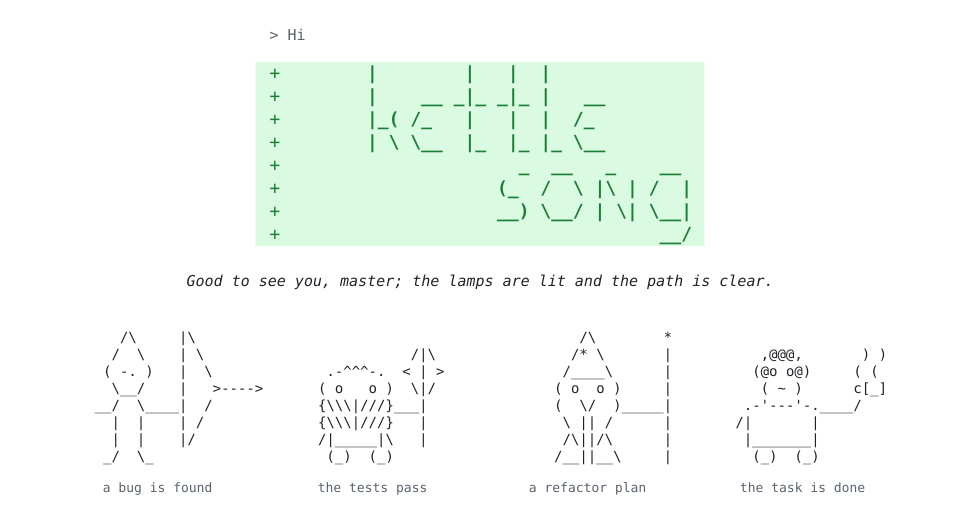

<picture>
  <source media="(prefers-color-scheme: dark)" srcset="art/cover-dark.svg">
  
</picture>

# Kettlesong

> A fantasy-fellowship voice for Claude Code. Your agent still writes clean code. It just talks like a cosy fellow traveler.

**Status:** latest release (0.1.2).

Kettlesong is a Claude Code plugin that ships one **output style**. When the style is active, Claude greets you, asks questions, reports failing tests and celebrates green tests with short lines in a cosy fantasy tone. It calls you "master" (you can change this). The themed lines are in italics, so they stand apart from the technical answer.

A green banner opens the first greeting of each session. At key moments, a small text figure joins the session:

| Figure | Moment |
|---|---|
| Elf with a bow | A bug is found |
| Dwarf with an axe | The tests pass after a fix |
| Wizard | A refactor or design proposal |
| Fire demon | A severe bug or a risk of data loss |
| Volcano | A production deploy or release |
| Small traveler with tea | The task is done |

A figure never appears in two replies in a row. To see fewer figures, or none, use the `art` setting.

Your code, commits, PRs and docs stay clean. The voice lives only in the chat.

## Example

A real session (shortened), as Claude Code shows it:

---

> **You:** Hi

```diff
+        |        |   |  |
+        |    __ _|_ _|_ |   __
+        |_( /_   |   |  |  /_
+        | \ \__  |_  |_ |_ \__
+                      _  __   _    __
+                    (_  /  \ |\ | /  |
+                    __) \__/ | \| \__|
+                                   __/
```

*Good to see you, master; the lamps are lit and the path is clear.*

You're on `fix/cart-total-off-by-one` and the working tree is clean. The latest commit is `5e38f1c Fix off-by-one error in Cart::total()`. ...

> **You:** review the off-by-one fix

*The wall holds, master; the fix is sound and the test passes.*

**The fix is correct.** The old condition `$i < count($this->items) - 1` skipped the last item. The new `$i < count($this->items)` covers every index. ...

Should I apply the `foreach` change and the two edge-case tests?

> **You:** yes

*Every guard is at their post, master, and none of them sounded the horn.*

`vendor/bin/pest` passes 3 tests with 3 assertions. Nothing is committed yet. ...

```text
             /|\
   .-^^^-.  < | >
  ( o   o )  \|/
  {\\\|///}___|
  {\\\|///}   |
  /|_____|\   |
   (_)  (_)
```

> **You:** yes, commit them

I committed both changes as `5221eb3` on `fix/cart-total-off-by-one`. I haven't pushed anything. ...

*That is the cart squared away, master, so the teapot can come out.*

---

The commit message (from `git log`) is plain:

```text
Use foreach in Cart::total() and add edge-case tests

Iterating with foreach removes the dependency on sequential array
keys. New tests cover an empty cart and a single-item cart.
```

## Install

```bash
/plugin marketplace add albertoarena/kettlesong
/plugin install kettlesong@kettlesong
/output-style kettlesong:Kettlesong
```

From a shell, use `claude plugin marketplace add` and `claude plugin install` with the same arguments.

To make it your default for all projects, set this in `~/.claude/settings.json`:

```json
{ "outputStyle": "kettlesong:Kettlesong" }
```

The value is case-sensitive and includes the plugin prefix.

## Update

```bash
/plugin marketplace update kettlesong
/reload-plugins
```

## Configure

Add these lines to your `CLAUDE.md` (project or user level). All are optional.

```text
kettlesong.address: Captain
kettlesong.intensity: light
kettlesong.art: rare
```

| Setting | Values | Default |
|---|---|---|
| `address` | any short form of address, or your name. A custom address is used exactly as written, in every language. | `master` (translated when you write in another language) |
| `intensity` | `light`, `medium`, `full` | `medium` |
| `art` | `off` (no art), `rare` (about one figure in 10 to 15 replies), `often` (a figure at every matching moment) | `often` (`off` at `light`) |

Languages: English and Italian. In other languages, the voice still follows your language, with the English names. To add a language, see `CONTRIBUTING.md`.

To stop the voice, write "quiet, please". To bring it back, write "voice on".

## What it never does

The style tells Claude to follow these rules. An eval suite (`evals/`) checks them.

- Never put themed text in code, comments, commit messages, PRs, changelogs or docs.
- Never quote the books or the films. Write original lines only.
- Go silent during production incidents, security issues and when you are frustrated.
- Keep the technical quality of the answer. The style keeps Claude Code's coding instructions on (`keep-coding-instructions: true`).

## Troubleshooting

- **Style not in the picker:** run `/reload-plugins`. If the style is still missing, restart Claude Code.
- **The style seems off after you set `outputStyle`:** check the value. It must be exactly `kettlesong:Kettlesong`. A wrong value gives the Default style with no error.
- **Claude codes worse with the style on:** `keep-coding-instructions` works only with the full system prompt. Set `CLAUDE_CODE_SIMPLE_SYSTEM_PROMPT=0`. It selects the full system prompt on any model.
- **The banner shows `+` signs with no color:** your client does not color `diff` blocks. The banner still reads correctly.
- **Subagents talk normally:** this is expected. Subagents use their own system prompt.

## Privacy

Kettlesong collects no data. It is one output style: a Markdown file with instructions for Claude. It has no code, hooks, MCP servers or connectors, and it sends nothing to any service.

The optional settings, such as `kettlesong.address`, stay in your own `CLAUDE.md`. Claude Code reads that file as usual. Kettlesong does not store or send them.

Your conversations go to Anthropic under your own Claude Code terms. Kettlesong adds no other recipient.

## Disclaimer

This project is a fan homage inspired by the work of J.R.R. Tolkien. It is not affiliated with, endorsed by or connected to the Tolkien Estate, Middle-earth Enterprises, or any film studio. It quotes no sentence from the books, their translations or the films. Names such as Middle-earth and Hobbit are trademarks of Middle-earth Enterprises and its licensees, used here only for reference.

## License

MIT
